# GeminiApiComposeStarter

**Course:** Mobile Application Development (MAD) — Assignment 1  
**Student:** Ritunjay Deo  
**Roll Number:** N023  
**Institution:** Mukesh Patel School of Technology Management & Engineering (NMIMS), Mumbai  
**Base Repository:** [ifahimkhan/GeminiApiComposeStarter](https://github.com/ifahimkhan/GeminiApiComposeStarter.git)  
**Branch:** `N023-ritunjay-deo`  

`GeminiApiComposeStarter` is a conversational Android application built with **Jetpack Compose** (Material 3), Google's **Gemini Generative AI Android SDK**, **Android KeyStore**-backed AES-256-GCM encryption at rest, **Room** offline persistence, **Preferences DataStore**, and **R8** release optimization. Originally a single-turn prompt starter, it has been re-engineered into a full conversational client featuring multi-turn context retention, voice dictation, reactive theme selection, and adaptive layouts across mobile and tablet form factors.

---

## Visual Demonstrations

### Core Conversation & Multi-Turn Context
| Initial Welcome | Gemini Response | Multi-Turn Memory |
| :---: | :---: | :---: |
| 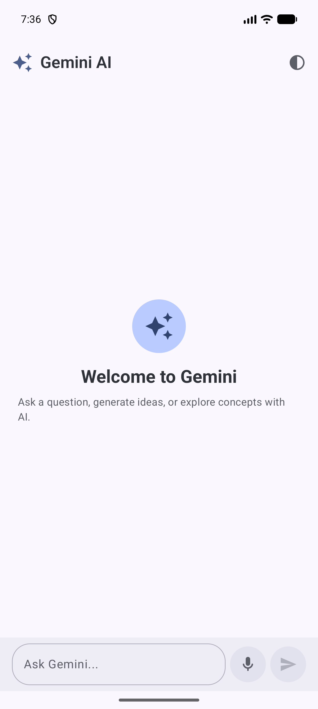 | 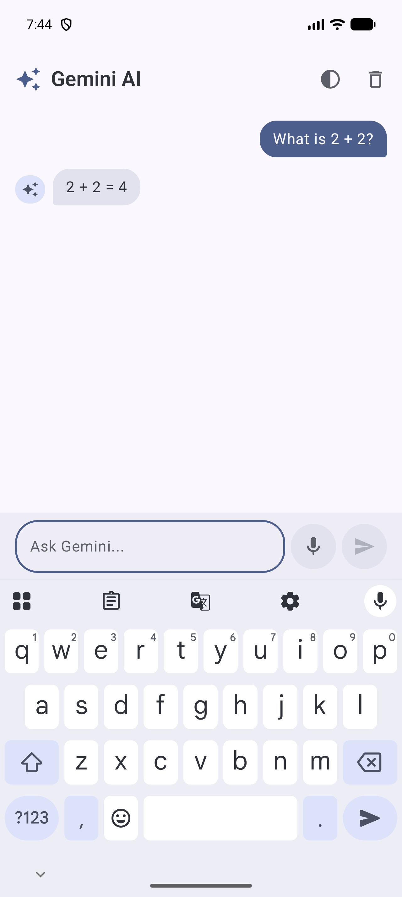 | 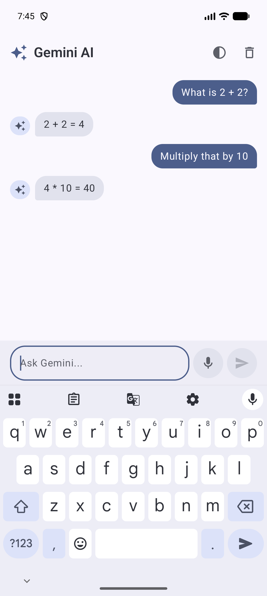 |

### UI States, Resilience & Confirmation
| Thinking / Loading State | Offline Error & Retry | Clear Chat Dialog |
| :---: | :---: | :---: |
| 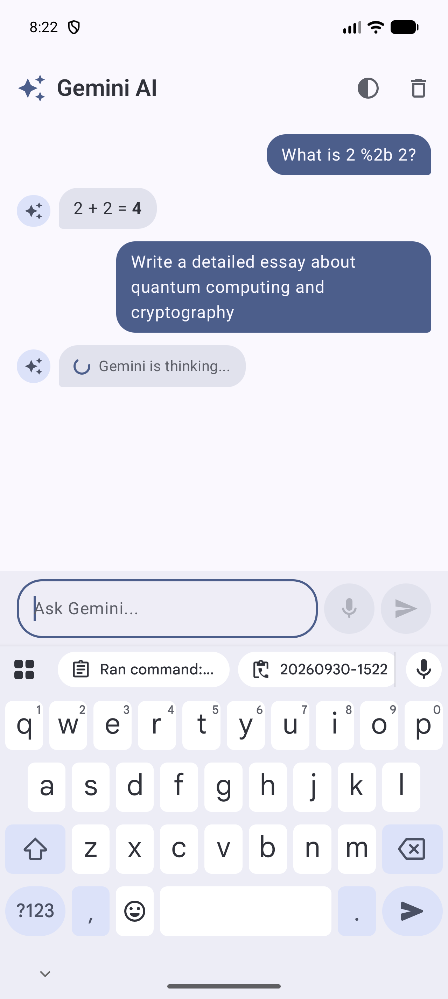 | 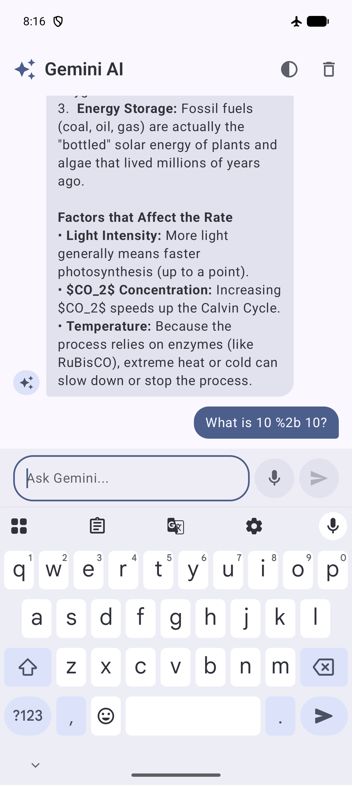 | 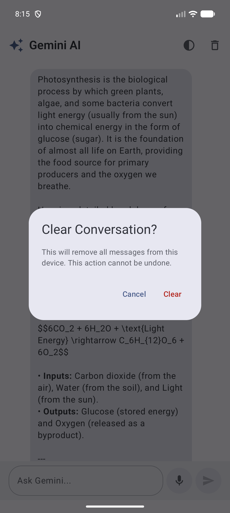 |

### Room & DataStore Persistence Across Process Death
| Room History Restored | Dark Theme Persisted | Adaptive Landscape |
| :---: | :---: | :---: |
| 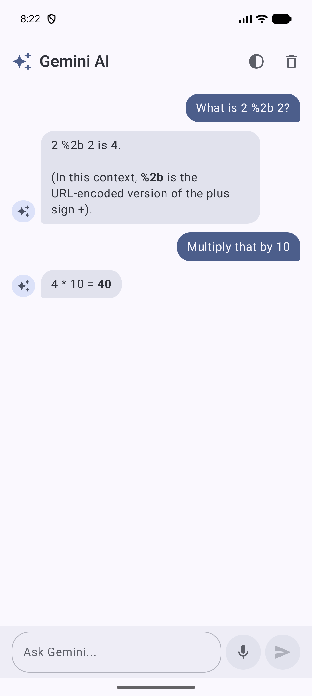 | 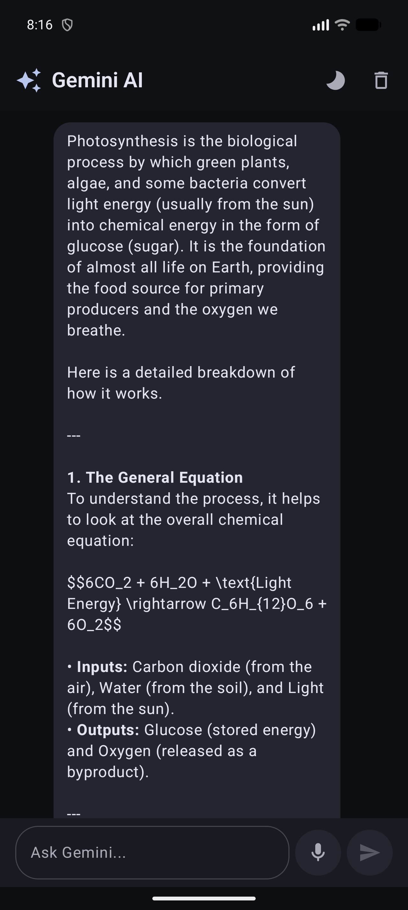 | 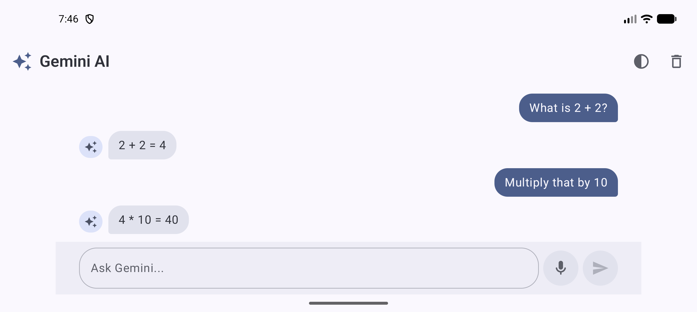 |

### Minified Release Runtime (R8 Verification) & Voice Intent
| Release APK Runtime | Release Multi-Turn Memory | Voice Input Dialog |
| :---: | :---: | :---: |
|  | 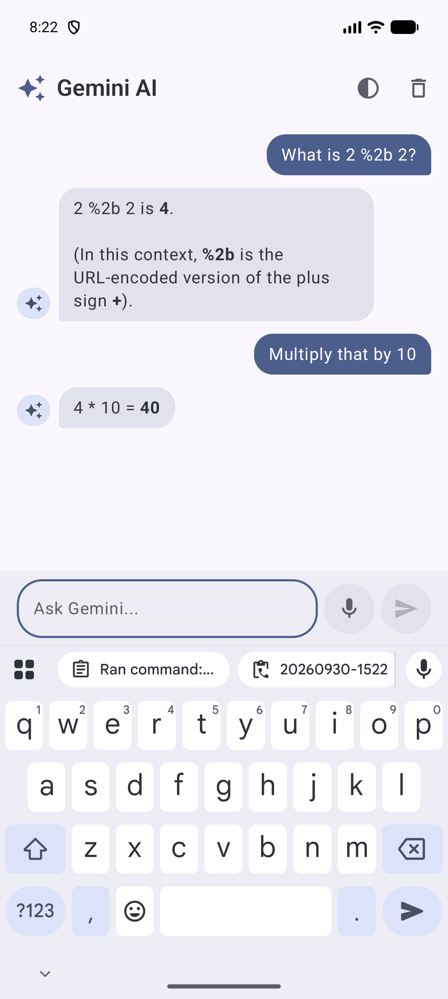 | 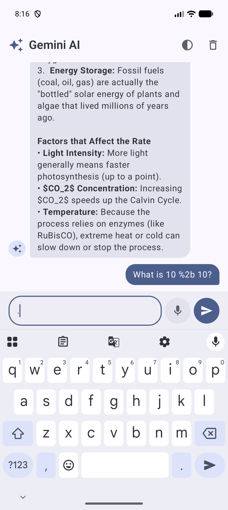 |

---

## Features

- **Gemini AI Chat**: Direct integration with Google's generative models (`gemini-3.8-flash` with resilient fallback to `gemini-3-flash-preview`).
- **Multi-Turn Conversation**: Full conversation history mapped to alternating user/model turns via `GenerativeModel.startChat()`, allowing the model to recall previous turns.
- **Material 3 Chat UI**: Distinct user and assistant message bubbles with custom bold markdown styling (`**text**`).
- **Stable Identifiers & Auto-Scroll**: `LazyColumn` keyed on UUIDs (`key = { it.id }`) with `LaunchedEffect` auto-scrolling to newly added messages.
- **Voice Dictation Intent**: Microphone button beside the composer triggers `RecognizerIntent.ACTION_RECOGNIZE_SPEECH` to append transcribed speech without auto-sending.
- **Room Chat Persistence**: Offline SQLite database (`gemini_chat.db`) preserves full chat history in chronological order across configuration changes and process death.
- **Preferences DataStore**: Manages application theme mode (`SYSTEM`, `LIGHT`, `DARK`) in `gemini_secure_prefs`, isolated from encryption keys.
- **Dynamic Theme Selection**: Interactive theme switcher in the top app bar supporting Material 3 dynamic color schemes on Android 12+.
- **Adaptive WindowSizeClass Layout**: Responsive container and bubble width constraints tailored for compact phones, foldables, and landscape tablets.
- **Hardware-Backed Credential Security**: Android KeyStore-generated AES-256 keys with AES-GCM encryption at rest in DataStore and in-memory decryption.
- **Transient Retry & Error Handling**: Non-blocking thinking indicators, transient 503 retry loop, model fallback resilience, and user-friendly error Snackbars with Retry.
- **R8 Release Hardening**: Minified release build with explicit keep rules for Room databases, DAOs, entities, and DataStore enums.
- **Comprehensive Automated Tests**: 93 automated tests (73 JVM unit tests + 20 connected instrumented tests) with 100% pass rate.

---

## Architecture

The project adheres to modern Android Architecture Components guidelines and Unidirectional Data Flow (UDF):

```
┌────────────────────────────────────────────────────────┐
│                        UI Layer                        │
│   MainActivity ──> ChatRoute ──> ChatScreen (Compose)  │
│        ▲                                               │
│        │ collects StateFlow<ChatUiState>               │
│        │                                               │
│   ChatViewModel (State Holder)                         │
└────────┬──────────────────────────────────┬────────────┘
         │                                  │
         ▼                                  ▼
┌──────────────────────────┐    ┌────────────────────────┐
│     Data Layer (AI)      │    │  Data Layer (Storage)  │
│   GeminiRepositoryImpl   │    │  ChatHistoryRepository │
│            │             │    │    │ (Room SQLite)     │
│   ApiKeyProvider         │    │  UserPreferencesRepo   │
│   (CryptoManager +       │    │    │ (Preferences      │
│    DataStore AES-GCM)    │    │       DataStore)       │
└──────────────────────────┘    └────────────────────────┘
```

- **UI Layer (`ui/chat`, `ui/theme`)**: Stateless composables (`ChatScreen`) hoist state to `ChatRoute`, collecting `ChatUiState` via `collectAsStateWithLifecycle()`.
- **State Holder (`ChatViewModel`)**: Manages optimistic message addition, active request job cancellation (`clearChat()`), voice result insertion, and error handling.
- **Data Layer (`data/`)**:
  - `GeminiRepository`: Coordinates API generation, multi-turn history mapping, retry policies, and fallback model switching.
  - `ApiKeyProvider`: Orchestrates key resolution, key rotation fingerprint validation, and DataStore encrypted persistence.
  - `ChatHistoryRepository`: Manages Room SQLite database operations on `Dispatchers.IO`.
  - `UserPreferencesRepository`: Reads and writes theme preferences via AndroidX Preferences DataStore.

---

## Project Structure

```
GeminiApiComposeStarter/
├── app/
│   ├── build.gradle.kts                # Module build config, SDK 36, R8, BuildConfig
│   ├── proguard-rules.pro              # Targeted keep rules for Room, DataStore, models
│   └── src/
│       ├── androidTest/java/.../       # 20 Connected Android instrumented tests
│       │   ├── data/local/             # Room DAO tests (ChatDaoTest)
│       │   ├── data/security/          # KeyStore crypto & secure provider tests
│       │   └── ui/chat/                # Compose UI tests (ChatScreenTest)
│       ├── main/
│       │   ├── AndroidManifest.xml     # Permissions, activities, hardware queries
│       │   ├── java/.../
│       │   │   ├── MainActivity.kt     # App entry, WindowSizeClass, manual DI factory
│       │   │   ├── data/               # Gemini repo, exceptions, config, seams
│       │   │   │   ├── local/          # Room entity, DAO, database, repository
│       │   │   │   ├── preferences/    # DataStore singleton, theme mode, repository
│       │   │   │   └── security/       # CryptoManager (KeyStore) & ApiKeyProvider
│       │   │   └── ui/
│       │   │       ├── chat/           # ChatScreen, ChatRoute, ChatViewModel, UiState
│       │   │       ├── text/           # BoldMarkdown parsing logic
│       │   │       └── theme/          # Color, Theme, Type definitions
│       │   └── res/                    # Vector drawables, mipmaps, strings, colors
│       └── test/java/.../              # 73 JVM unit tests
│           ├── data/                   # Repository, retry, and exception tests
│           ├── local/                  # Room repository and entity mapping tests
│           ├── preferences/            # DataStore preference logic tests
│           ├── security/               # ApiKeyProvider unit tests & rotation
│           └── ui/                     # ViewModel state machine & markdown tests
├── docs/
│   ├── TESTING.md                      # Detailed testing guide and runtime evidence
│   └── screenshots/                    # Submission screenshots (01 to 15)
├── gradle/libs.versions.toml           # Version catalog (AGP 9.0, Kotlin 2.0.21, etc.)
├── local.properties.example            # Template for configuring local API key
├── PR_DESCRIPTION.md                   # Submission pull request description
└── README.md                           # Project documentation
```

---

## Setup & Execution

### Prerequisites
- **Android Studio**: Android Studio Otter (2025.1.1+) or newer.
- **JDK**: Java 17+ (required by AGP 9.0 and Gradle 9.3).
- **Android SDK**: Platform 36 installed via SDK Manager.

### Step-by-Step Setup
1. **Clone the repository**:
   ```bash
   git clone -b N023-ritunjay-deo https://github.com/AkkiSensei/GeminiApiComposeStarter.git
   cd GeminiApiComposeStarter
   ```
2. **Open in Android Studio**:
   Open the cloned folder in Android Studio and allow Gradle to sync.
3. **Configure your Gemini API Key**:
   Create a `local.properties` file in the project root (or copy from `local.properties.example`):
   ```properties
   GEMINI_API_KEY=YOUR_API_KEY_HERE
   ```
   *(Note: `local.properties` is strictly ignored by Git and will never be tracked).*
4. **Sync Project**:
   Click **File > Sync Project with Gradle Files**.
5. **Run the App**:
   Select an active emulator or connected device and click **Run 'app'** (`Shift+F10`).

---

## Security Architecture

1. **Development Key Isolation**: The API key is stored in `local.properties`, which is excluded from source control by `.gitignore` and enforced via a local pre-commit hook and Gitleaks configuration.
2. **Hardware-Backed Android KeyStore**: `CryptoManager` generates an AES-256 master key directly inside the `AndroidKeyStore` provider (`AES/GCM/NoPadding`).
3. **Encryption at Rest**: On first launch, `SecureApiKeyProvider` encrypts the key using a unique, cryptographically random 12-byte initialization vector (IV) and a 128-bit authentication tag. The ciphertext and IV are persisted in Preferences DataStore (`gemini_secure_prefs.preferences_pb`).
4. **On-Demand Decryption**: The key is decrypted into memory strictly when needed inside an IO coroutine dispatcher (`Dispatchers.IO`) and cached in memory for the process lifetime.
5. **Key Rotation & Safe Purge**: The app records a SHA-256 fingerprint of the configured key. If `local.properties` is updated, the stored ciphertext is re-encrypted on next launch. If the key is cleared or removed, stored credentials are automatically purged from DataStore.
6. **No Secret Logging**: API keys, decrypted strings, and authentication tokens are strictly excluded from Android Logcat and error exceptions.

> [!NOTE]
> **Client-Side Security Scope**:
> In accordance with standard Android architecture, client-side encryption protects credentials against unauthorized local file-system access (such as non-rooted device backups or unprivileged file inspection). However, because the initial key literal is compiled into `BuildConfig.GEMINI_API_KEY`, decompiling client APK bytecode can expose the embedded constant. In commercial production apps, API calls should be proxied through an authenticated backend server.

---

## Testing & Verification

The project includes an automated test suite comprising **93 passing automated tests**:

```bash
# Run all 73 JVM unit tests
.\gradlew.bat testDebugUnitTest --rerun

# Run all 20 connected instrumented tests on active device/emulator
.\gradlew.bat connectedDebugAndroidTest

# Build debug and minified release APKs
.\gradlew.bat assembleDebug
.\gradlew.bat assembleRelease

# Run static code analysis
.\gradlew.bat lintDebug lintRelease
```

For the complete breakdown of test cases, test classes, and emulator verification results, see [docs/TESTING.md](docs/TESTING.md).

---

## Release Build & R8 Optimization

The release build enables full R8 code shrinking and resource optimization:
```kotlin
buildTypes {
    release {
        isMinifyEnabled = true
        // Debug certificate signing is enabled for assignment evaluation and local QA testing
        signingConfig = signingConfigs.getByName("debug")
        proguardFiles(
            getDefaultProguardFile("proguard-android-optimize.txt"),
            "proguard-rules.pro"
        )
    }
}
```

- **Academic Testing Rationale**: Release builds use debug certificate signing so the obfuscated release APK can be installed via ADB (`adb install -r app/build/outputs/apk/release/app-release.apk`) on standard emulator images without requiring a private production signing key.
- **R8 Rules (`proguard-rules.pro`)**: Protects reflection boundaries, Room database implementations (`RoomDatabase`), DAOs, `ChatMessageEntity`, DataStore `ThemeMode` enums, and UI state models.
- **Verified Runtime Performance**: The minified release APK was installed and tested on a live device, executing multi-turn Gemini requests (`"What is 5 + 5?"` -> `"5 + 5 = 10"`) without reflection errors.

---

## Known Limitations

1. **Virtual Emulator Audio Input**: The speech recognition intent (`RecognizerIntent.ACTION_RECOGNIZE_SPEECH`) and error fallback are fully verified. However, live acoustic voice-to-text dictation requires a physical microphone and active speech engine configured on the host device.
2. **Third-Party API Free-Tier Quota**: The Google Gemini API free-tier enforces a rate limit (20 requests per minute). The app implements retry logic and fallback model switching to handle transient capacity limits.
3. **Single Global Chat Timeline**: The local Room database maintains a single sequential timeline of messages. Multiple parallel conversation threads and cloud sync are not implemented in this version.

---

## Academic Integrity & License

This project is submitted for evaluation in the **Mobile Application Development (MAD)** course at NMIMS MPSTME.  
Student Name: **Ritunjay Deo** | Roll Number: **N023**.  
Original starter code by **Fahim Khan** (`ifahimkhan/GeminiApiComposeStarter`).
