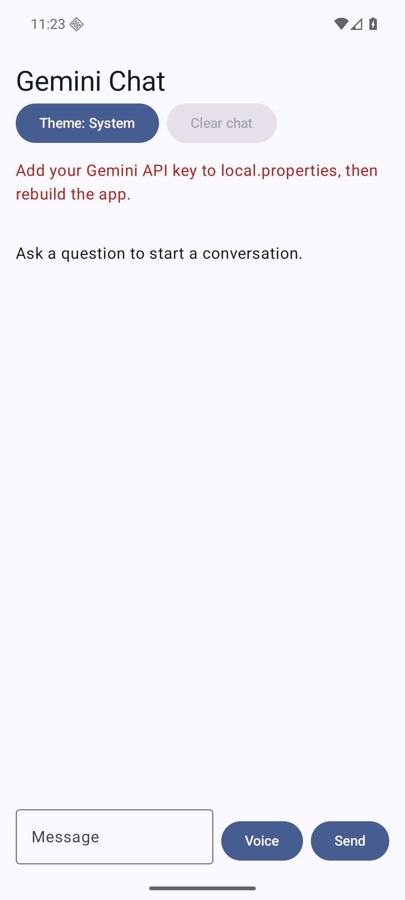
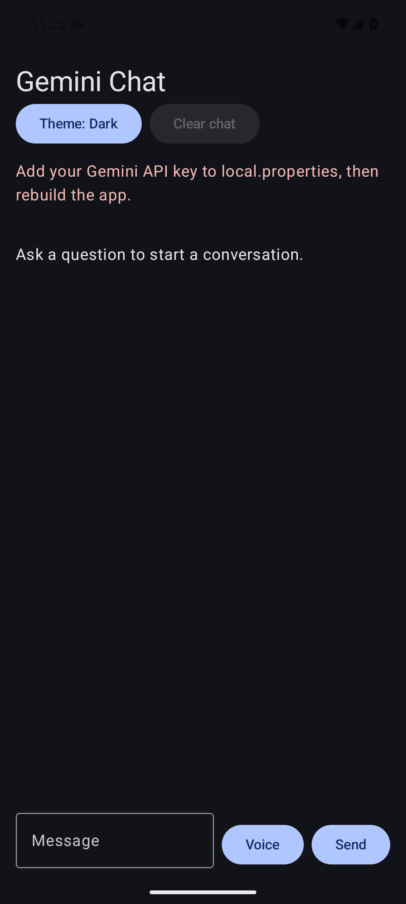

# MAD Assignment 1 — Gemini Chat

Android chat app built with Jetpack Compose for Mobile Application Development. It is developed on a fork of the course's [Gemini Compose starter](https://github.com/ifahimkhan/GeminiApiComposeStarter) and adds a conversation UI, speech input, saved chat history, theme preferences, and key handling.

Hrishikesh Salokhe · N088 · MBA Tech CE · E1. Course video reference: [Android Development #8](https://www.youtube.com/watch?v=r2NIFXd0PQY).

## Setup

1. Open this folder in Android Studio and allow Gradle sync to finish.
2. Copy `local.properties.example` to `local.properties`, or use the existing Android Studio generated `local.properties` file.
3. Keep the `sdk.dir` value for your machine. Add `GEMINI_API_KEY=your_real_key` on a new line. Obtain a key from [Google AI Studio](https://aistudio.google.com/app/apikey). The file is ignored by Git. For CI, set the `GEMINI_API_KEY` environment variable instead.
4. Run the `app` configuration on an Android device or emulator with API 26 or later.

Without a key, the app still opens and explains what to configure, but it cannot send requests. Speech input needs an installed Android speech recognizer.

## Features

- Material 3 chat bubbles in a keyed `LazyColumn`, with automatic scrolling, loading feedback, and error messages.
- A single `ChatUiState` exposed by `ChatViewModel` as `StateFlow`; the screen collects it with `collectAsStateWithLifecycle()`.
- Compact and wide layouts based on `WindowSizeClass`, plus system, dark, and light appearance modes with dynamic color where Android supports it.
- Voice dictation through `RecognizerIntent` and the Activity Result API.
- Conversation history stored with Room and appearance choice stored with Preferences DataStore.

## Emulator screenshots

The app was launched without a Gemini key. These are genuine emulator captures of the setup state and the dark theme after restarting the app.

| System theme | Dark theme after restart |
| --- | --- |
|  |  |

## Key handling

Gradle reads the key from ignored `local.properties`, then falls back to the `GEMINI_API_KEY` environment variable. It exposes the value to the app through `BuildConfig`. At first launch, `ApiKeyVault` creates an AES-256-GCM key in Android Keystore, encrypts the Gemini key, and stores only ciphertext and IV in app preferences. It decrypts the key in memory when `GeminiRepositoryImpl` creates a `GenerativeModel`. The encrypted preferences file is excluded from backup and device transfer. The release build uses R8 shrinking and obfuscation.

This protects the stored value but **does not make a client-side API key secret**: a key embedded in an APK can be extracted by a determined attacker. For production, move Gemini requests behind a backend proxy, or migrate to [Firebase AI Logic](https://firebase.google.com/docs/ai-logic) with Firebase App Check and a restricted key. The starter's Google AI Android client SDK is [deprecated](https://firebase.google.com/docs/ai-logic/migrate-from-google-ai-client-sdks); it remains here to match the assignment's `GenerativeModel` requirement.

## Tests

Run local ViewModel tests:

```text
gradlew.bat :app:testDebugUnitTest
```

Run Compose UI tests with a connected device or emulator:

```text
gradlew.bat :app:connectedDebugAndroidTest
```

The ViewModel tests cover sending, blank input, API errors, and restored history/theme. The device tests check conversation content, the send action, and Room history after reopening the database.
