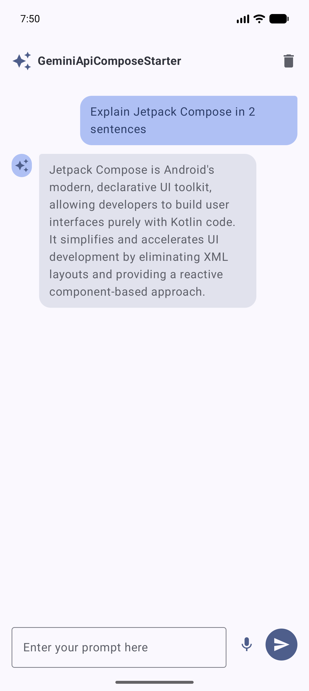
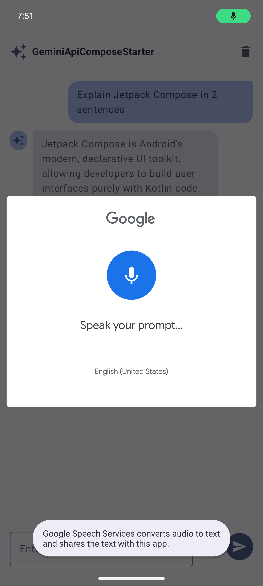
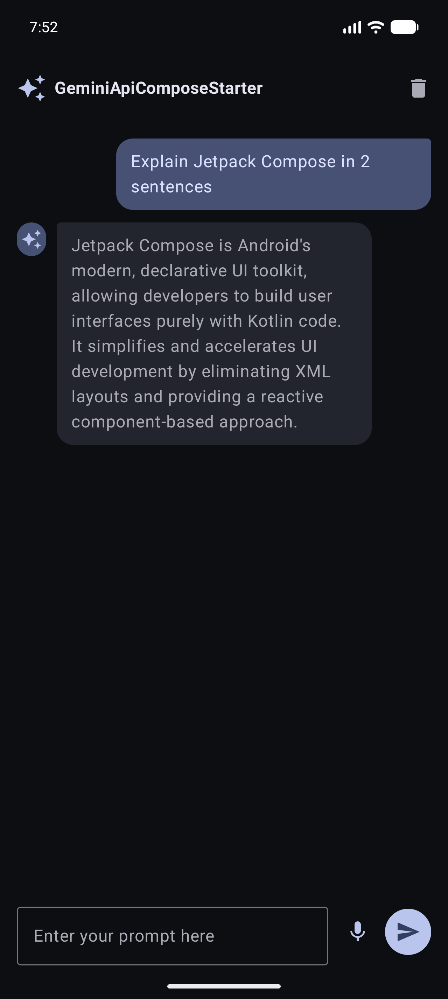
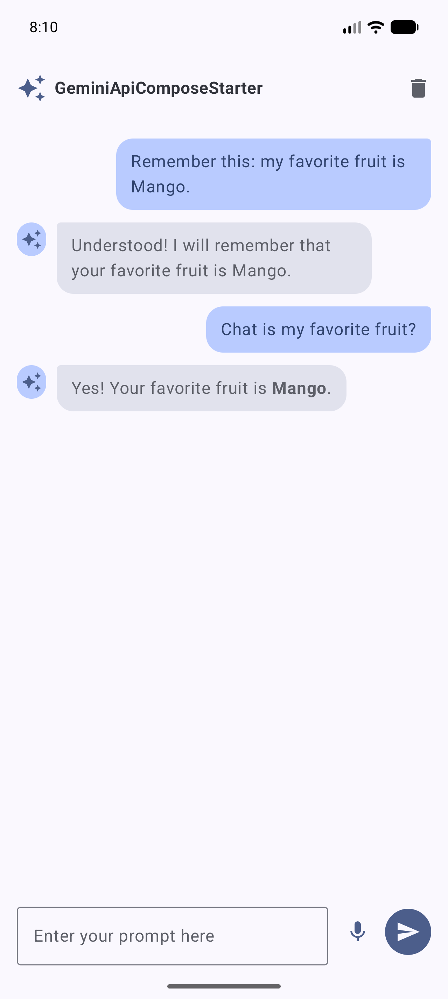

# Gemini Chat - Android Jetpack Compose Lab Assignment

A modern, responsive, and secure Android chat application built with **Jetpack Compose**, **Google Generative AI (Gemini)**, **Room Database**, **Preferences DataStore**, and **Android Keystore AES-256-GCM** encryption.

---

## 🌟 Features

- **Modern Material 3 Chat UI**:
  - Conversational message bubbles (`LazyColumn`) with distinct visual styling for User and Gemini.
  - Formatted text rendering with support for markdown bold (`**text**`).
  - Stable keys on all list items for optimal recomposition and performance.
  - Auto-scroll to the latest message on arrival of responses or user prompts.
- **Clean Architecture & Unidirectional Data Flow (UDF)**:
  - Centralized immutable UI state encapsulated in `ChatUiState`.
  - Reactive state emission via `StateFlow` from `ChatViewModel`.
  - Lifecycle-aware state observation in Compose via `collectAsStateWithLifecycle()`.
  - Stateless composables achieved through comprehensive state hoisting.
- **Adaptive & Responsive Layouts**:
  - Utilizes `WindowSizeClass` (`WindowWidthSizeClass`).
  - **Compact/Medium** (Phones): Seamless single-column conversation view with an intuitive prompt input bar.
  - **Expanded** (Foldables / Tablets / Large screens): Two-pane layout with a side info/actions card and centered conversation view.
- **Voice Input**:
  - Speech-to-text integration using `RecognizerIntent.ACTION_RECOGNIZE_SPEECH`.
  - Voice action button allows speaking prompts directly into the chat.
- **Loading & Error Handling**:
  - Visual typing/thinking bubble indicator when Gemini is generating responses.
  - Contextual error banners and snackbars with dismiss and retry handling.
  - Welcome placeholder card when chat history is empty.
  - Empty field validation (`PromptError.EMPTY`).
- **Data Persistence**:
  - **Room Database**: Complete offline persistence of message history (`ChatMessageEntity`, `ChatDao`, `AppDatabase`).
  - **Preferences DataStore**: Stores user preferences such as selected model and auto-scroll behavior.
- **Security & Keystore Architecture**:
  - API key protection using **Android Keystore AES-256-GCM** (`AES/GCM/NoPadding`).
  - Zero plaintext API key storage on disk.
  - `local.properties` ignored in VCS with `local.properties.example` template.
  - Environment variable fallback (`GEMINI_API_KEY`) for CI/CD pipelines.
- **Production-Ready**:
  - Full R8 / ProGuard code minification and resource shrinking configured for release builds.
  - Unit tests with a deterministic `FakeGeminiRepository`.
  - Compose UI tests verifying rendering, input, and interactions.

---

## 📸 Screenshots

| 1. Live Chat Execution | 2. Voice Input (`RecognizerIntent`) |
| :---: | :---: |
|  |  |

| 3. Dark Mode Theme | 4. Chatbot with Context (Multi-Turn) |
| :---: | :---: |
|  |  |

---

## 🏗️ Architecture Overview

```
                      ┌──────────────────────────────────────────────┐
                      │              Jetpack Compose UI              │
                      │  (ChatScreen, MessageBubble, PromptBar)       │
                      └──────────────────────▲───────────────────────┘
                                             │ collectAsStateWithLifecycle()
                                             │ User Actions (onSend, etc.)
                      ┌──────────────────────▼───────────────────────┐
                      │                ChatViewModel                 │
                      │         (StateFlow<ChatUiState>)             │
                      └──────────────┬────────────────┬──────────────┘
                                     │                │
           ┌─────────────────────────▼──┐   ┌─────────▼────────────────────────┐
           │      GeminiRepository      │   │       ChatHistoryRepository      │
           │ (Google Generative AI SDK) │   │          (Room Database)         │
           └─────────────▲──────────────┘   └─────────────────▲────────────────┘
                         │                                    │
           ┌─────────────┴──────────────┐   ┌─────────────────┴────────────────┐
           │       CryptoManager        │   │    UserPreferencesRepository     │
           │ (Android Keystore AES-256) │   │      (Preferences DataStore)     │
           └────────────────────────────┘   └──────────────────────────────────┘
```

---

## 🔐 Security Architecture

This application employs defense-in-depth to protect the Gemini API key:

1. **Hardware-Backed Key Generation**:
   - `CryptoManager` generates a 256-bit AES key directly inside the `AndroidKeyStore`.
   - The private cryptographic key material never leaves the secure hardware boundary (TEE / StrongBox).
2. **Authenticated Encryption (AES-256-GCM)**:
   - Plaintext keys provided via build configuration or user input are encrypted using Galois/Counter Mode (`AES/GCM/NoPadding`) with a 128-bit authentication tag and a cryptographically random 12-byte initialization vector (IV).
3. **Encrypted At Rest**:
   - The encrypted ciphertext and its corresponding IV are saved into Jetpack Preferences DataStore.
   - Plaintext API keys are **never** written to SharedPreferences, SQLite, or unencrypted storage.
4. **Decryption On Demand**:
   - `GeminiRepositoryImpl` receives a dynamic `apiKeyProvider: suspend () -> String` lambda.
   - The API key is decrypted in volatile memory (RAM) strictly when an API request is initiated and is garbage-collected after the session.
5. **VCS Protection**:
   - `local.properties` is explicitly declared in `.gitignore`.
   - A template `local.properties.example` is provided for onboarding without leaking secrets.
   - CI environments can provide `GEMINI_API_KEY` as a system environment variable.

---

## 🚀 Setup & Getting Started

### Prerequisites
- **Android Studio** (Ladybug / Meerkat or later) or command line with Android SDK.
- **JDK 17** or **JDK 21**.
- **Android SDK Platform 36** (Compile SDK: 36, Min SDK: 26).

### 1. Clone the Repository
```bash
git clone https://github.com/Nidhishmodi/N064Nidhish.git
cd N064Nidhish
```

### 2. Configure API Key and SDK Location
Copy the provided template file:
```bash
cp local.properties.example local.properties
```

Edit `local.properties` with your Android SDK directory and Gemini API key from [Google AI Studio](https://aistudio.google.com/):
```properties
sdk.dir=C\:\\Users\\YourUsername\\AppData\\Local\\Android\\Sdk
GEMINI_API_KEY=your_actual_gemini_api_key_here
```

> **Warning**: Never commit `local.properties` to version control.

### 3. CI / Continuous Integration Setup
In CI environments (e.g. GitHub Actions, GitLab CI), you do not need `local.properties`. Simply expose the secret as an environment variable:
```bash
export GEMINI_API_KEY="your_ci_gemini_api_key"
export ANDROID_HOME="/path/to/android/sdk"
```
The build script automatically detects and uses `System.getenv("GEMINI_API_KEY")`.

---

## 🧪 Testing

### Running Unit Tests
Unit tests verify the `ChatViewModel` state transitions, empty prompt validation, missing API key handling, success/failure response flows, and conversation clearing using a `FakeGeminiRepository`:
```bash
./gradlew testDebugUnitTest
```

### Running Compose UI Tests
Compose UI tests verify that messages render in the `LazyColumn`, prompt input works, send and clear buttons trigger actions, and loading indicators appear correctly:
```bash
./gradlew connectedAndroidTest
```

---

## 📦 Building for Release (R8 Minification)

The release build enables R8 code shrinking, obfuscation, and resource optimization:
```bash
./gradlew assembleRelease
```
The resulting minified APK will be generated at:
`app/build/outputs/apk/release/app-release-unsigned.apk`
