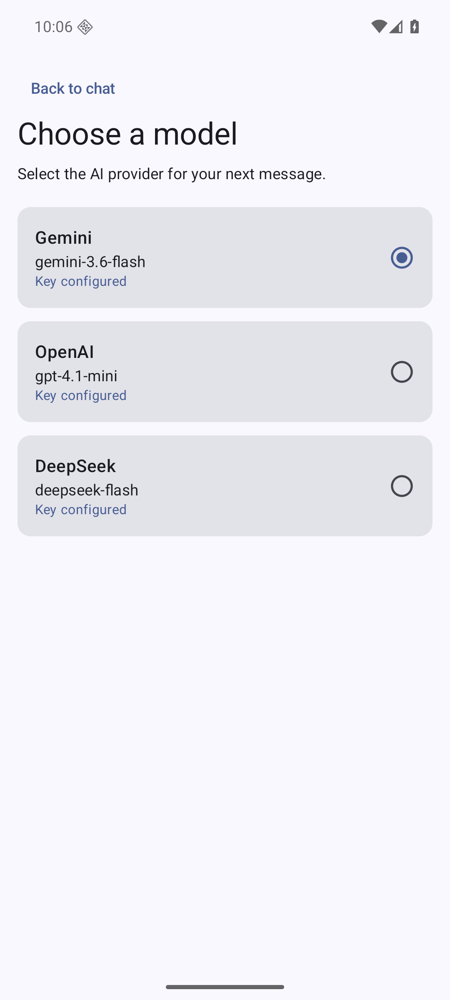
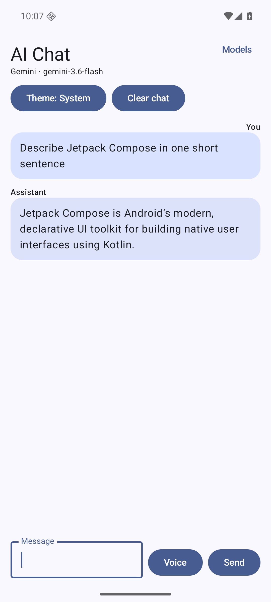
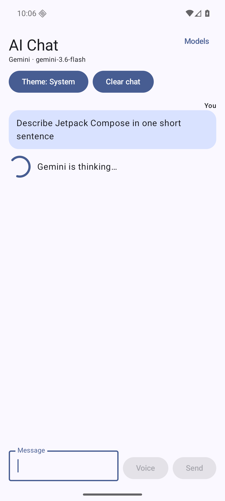
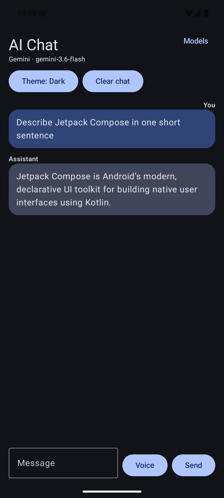
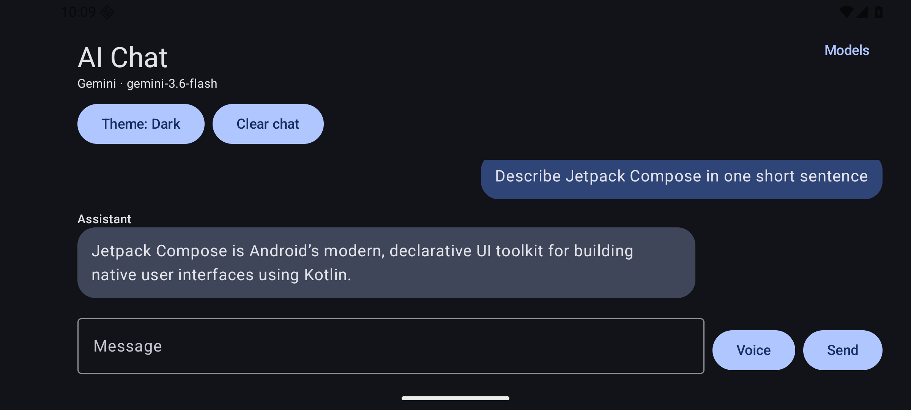

# MAD Assignment 1 — AI Chat

Android chat app built with Jetpack Compose for Mobile Application Development. It is developed on a fork of the course's [Gemini Compose starter](https://github.com/ifahimkhan/GeminiApiComposeStarter) and adds a model selector for Gemini, OpenAI, and DeepSeek, a conversation UI, speech input, saved chat history, theme preferences, and key handling.

Hrishikesh Salokhe · N088 · MBA Tech CE · E1. Course video reference: [Android Development #8](https://www.youtube.com/watch?v=r2NIFXd0PQY).

## Setup

1. Open this folder in Android Studio and allow Gradle sync to finish.
2. Copy `local.properties.example` to `local.properties`, or use the existing Android Studio generated `local.properties` file.
3. Keep the `sdk.dir` value for your machine. Add keys for the providers you want to use: `GEMINI_API_KEY`, `OPENAI_API_KEY`, and `DEEPSEEK_API_KEY`. Obtain them from [Google AI Studio](https://aistudio.google.com/app/apikey), the [OpenAI API dashboard](https://platform.openai.com/api-keys), and the [DeepSeek platform](https://platform.deepseek.com/). The file is ignored by Git. CI can provide the same names as environment variables.
4. Run the `app` configuration on an Android device or emulator with API 26 or later.

Without a key for the selected provider, the app still opens and explains what to configure, but it cannot send requests to that provider. Speech input needs an installed Android speech recognizer.

## Features

- Material 3 chat bubbles in a keyed `LazyColumn`, with automatic scrolling, loading feedback, and error messages.
- A model selector screen for Gemini (`gemini-3.6-flash`), OpenAI (`gpt-4.1-mini`), and DeepSeek (`deepseek-flash`). The choice survives app restarts.
- A single `ChatUiState` exposed by `ChatViewModel` as `StateFlow`; the screen collects it with `collectAsStateWithLifecycle()`.
- Compact and wide layouts based on `WindowSizeClass`, plus system, dark, and light appearance modes with dynamic color where Android supports it.
- Voice dictation through `RecognizerIntent` and the Activity Result API.
- Conversation history stored with Room and appearance choice stored with Preferences DataStore.

## Emulator screenshots

These are captures from the running app with Gemini configured. The response shown below came from a live Gemini request.

| Model selector | Gemini response (light theme) |
| --- | --- |
|  |  |

| Loading feedback | Dark theme |
| --- | --- |
|  |  |

| Restored chat after app restart | Wide layout |
| --- | --- |
|  |  |

## Key handling

Gradle reads each key from ignored `local.properties`, then falls back to its matching environment variable. It exposes configured values to the app through `BuildConfig`. At first launch, `ApiKeyVault` creates a separate AES-256-GCM key in Android Keystore for each provider, encrypts the API keys, and stores only ciphertext and IV values in Preferences DataStore. It decrypts a key in memory only when sending a request to that provider. The credential DataStore file is excluded from backup and device transfer. The release build uses R8 shrinking and obfuscation.

This protects stored values but **does not make client-side API keys secret**: keys embedded in an APK can be extracted by a determined attacker. For production, move provider requests behind a backend proxy; for Gemini, [Firebase AI Logic](https://firebase.google.com/docs/ai-logic) with Firebase App Check is another option. The starter's Google AI Android client SDK is [deprecated](https://firebase.google.com/docs/ai-logic/migrate-from-google-ai-client-sdks); it remains here to match the assignment's `GenerativeModel` requirement.

## Tests

Run local ViewModel tests:

```text
gradlew.bat :app:testDebugUnitTest
```

Run Compose UI tests with a connected device or emulator:

```text
gradlew.bat :app:connectedDebugAndroidTest
```

The ViewModel tests cover sending, blank input, API errors, restored history/theme, and provider selection and routing. The device tests check conversation content, the model selector, Room history after reopening the database, and encrypted key storage.
