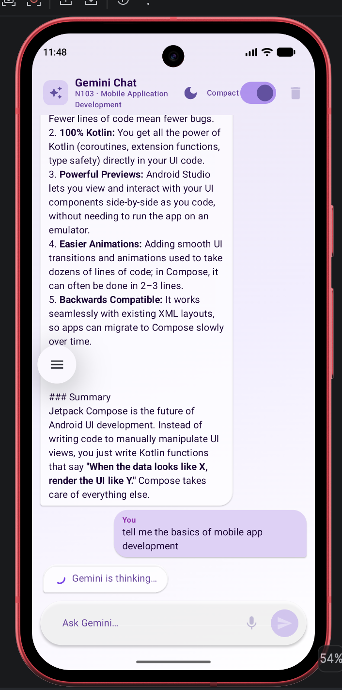
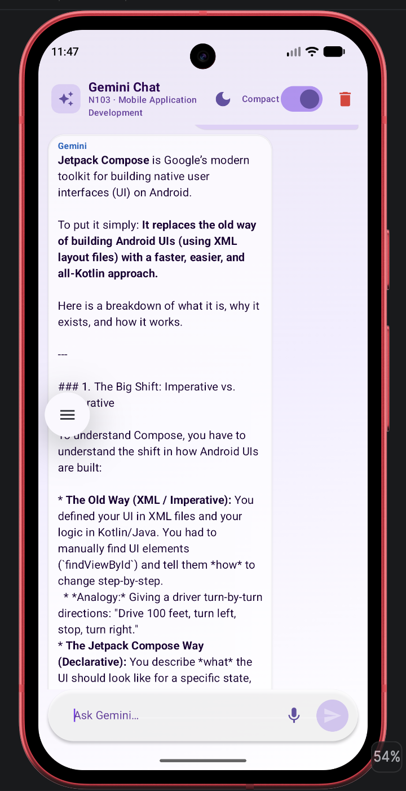
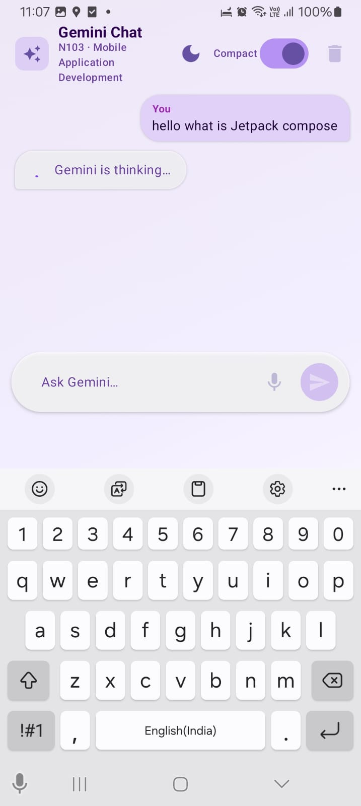
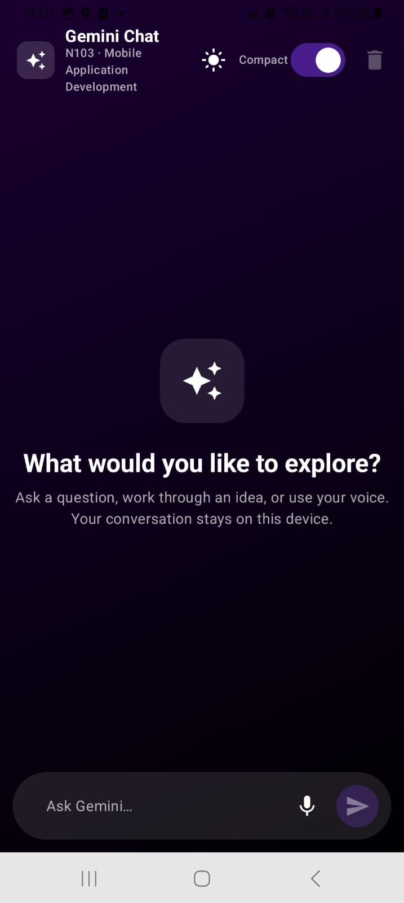
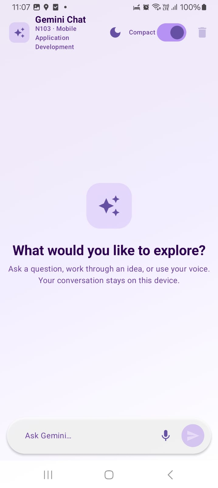
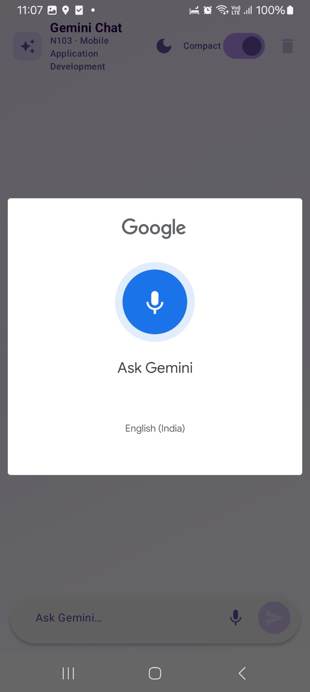
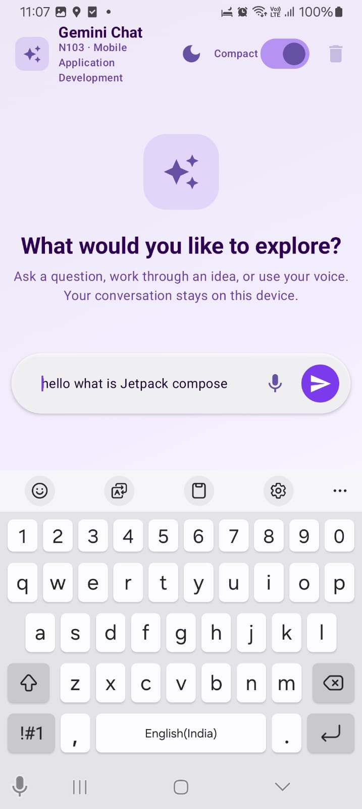

# N103 Assignment 1 — Gemini Chat Enhancements

Completes the starter chat interface with persisted Room history, voice input, a compact-bubble DataStore preference, adaptive Material 3 layouts, explicit loading/error handling, and a manual dark/light mode toggle. Chat state is hoisted into a lifecycle-aware ViewModel; the API key is encrypted with an Android Keystore AES-256-GCM key and stored as ciphertext in DataStore. The Gemini SDK is replaced with a direct REST call so that both legacy (`AIzaSy…`) and newer (`AQ.`) API key formats are supported.

## Implemented Features

- Material 3 chat bubbles with stable Room message IDs, LazyColumn and auto-scroll
- ViewModel-owned `ChatUiState` exposed as `StateFlow`, lifecycle-aware collection
- Voice-to-text via `RecognizerIntent`
- Room chat history that survives app restarts
- Compact-bubble preference in Preferences DataStore
- Manual dark / light mode toggle (cycles system → dark → light), persisted in DataStore
- Pastel purple/white gradient (light) and deep purple/black gradient (dark)
- Nunito Google Font applied across all text styles
- Android Keystore AES-256-GCM encryption of API key at rest
- Direct Gemini REST API call (compatible with both `AIzaSy…` and `AQ.` key formats)
- Window size classes — constrained width on tablets
- R8 minification on release builds

## Screenshots

| Light mode — response | Dark mode | Loading |
|---|---|---|
|  |  |  |

| Voice input | Error state | Empty state | Compact mode |
|---|---|---|---|
|  |  |  |  |

## Security

Gradle reads `GEMINI_API_KEY` from the git-ignored `local.properties` (or `GEMINI_API_KEY` env variable for CI). On first launch an AES-256-GCM key is generated inside the Android Keystore; only ciphertext and IV are stored in DataStore. The plaintext key is decrypted in memory only at request time and never logged or displayed. `BuildConfig` embeds the key in the APK — for production, move calls behind a backend proxy or use Firebase App Check.

## Tests

```bash
./gradlew testDebugUnitTest
./gradlew connectedDebugAndroidTest
./gradlew assembleDebug assembleRelease
```

🤖 Generated with [Claude Code](https://claude.com/claude-code)
